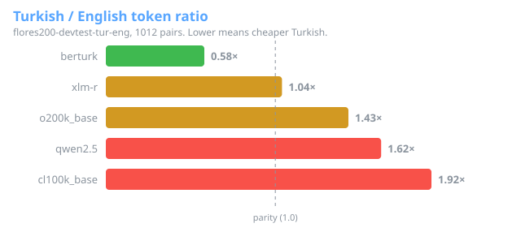

# Turkish Token Tax

Reproducible Turkish–English tokenizer efficiency measurements. Python 3.11+.
Status: early release. No package is on PyPI yet, and the Kaggle and Hugging Face
drafts in `drafts/` are reviewed by hand before anything is uploaded.

## Development

```sh
python -m venv .venv
# Activate .venv with your shell's standard activation command.
python -m pip install -e ".[dev,tokenizers]"
python -m pytest
ruff check .
```

Unit tests are offline, use synthetic fixtures and enforce 90% branch/line coverage.
CI runs Python 3.11 and 3.14 on Linux and Python 3.14 on Windows.

## Run

```sh
ttt run --config configs/default.yaml
ttt run --config configs/default.yaml --offline
ttt leaderboard --report results/benchmark.json --readme README.md
```

First run downloads the 25.6 MB original corpus archive and tokenizer artifacts
into `.cache/`; no API key, model weights or paid inference are used. Later runs
reverify the cache. Results are `results/benchmark.json`, `benchmark.md` and
`benchmark.html` (with a ratio chart). Do not run `--offline` on an empty cache.

## Initial measurements

Full FLORES-200 devtest (1,012 aligned pairs), observed 19 October 2026.


The table below is generated by `ttt leaderboard`; machine-readable evidence
is in [benchmarks/flores200-devtest.json](benchmarks/flores200-devtest.json).

<!-- leaderboard:start -->
| Tokenizer | TR / EN | TR tokens / word | TR chars / token |
|---|---:|---:|---:|
| berturk | 0.5809 | 1.5616 | 4.9376 |
| xlm-r | 1.0392 | 1.8094 | 4.2614 |
| o200k_base | 1.4311 | 2.1840 | 3.5306 |
| qwen2.5 | 1.6242 | 2.5477 | 3.0265 |
| cl100k_base | 1.9212 | 2.9656 | 2.6000 |
<!-- leaderboard:end -->

BERTurk uses the fewest Turkish tokens in this sample; it and XLM-R are encoder
references. Among the measured generative encodings, **o200k_base** uses the fewest
Turkish tokens and has the lowest TR/EN ratio. A Turkish-specific encoder's low
ratio also reflects poor English token efficiency; it is not an LLM quality win.

See [METHOD.md](METHOD.md) for denominators, limitations and diagnostics, and
[CONTRIBUTING.md](CONTRIBUTING.md) for adding a tokenizer. Llama, Gemma, Mistral,
Qwen3, mT5 and domain subsets have not been measured. No API-price comparison is made.

## Publication drafts

`ttt drafts` writes a private Kaggle dataset and a static Hugging Face Space to `drafts/`. They contain aggregate numbers only, never corpus text, and carry the CC-BY-SA-4.0 data license with FLORES-200 attribution. `drafts/MANIFEST.json` records each file's SHA-256 and the lock hashes behind it. Nothing is uploaded automatically: publishing is a separate, explicitly approved step.

## Data

The default is the complete 1,012-pair FLORES-200 Turkish/English devtest split.
See [DATA.md](DATA.md) for source, attribution, CC-BY-SA-4.0 data licensing and
immutable content hashes. Code is MIT; data licenses are separate.

## Roadmap

1. [Verified corpus loaders and licensing](https://github.com/eyupcodes/turkish-token-tax/issues/1)
2. [Cached, pinned tokenizer adapters](https://github.com/eyupcodes/turkish-token-tax/issues/2)
3. [Metrics, deterministic CLI and tests](https://github.com/eyupcodes/turkish-token-tax/issues/3)
4. [Reports and leaderboard automation](https://github.com/eyupcodes/turkish-token-tax/issues/4)
5. [Licensed domain subsets](https://github.com/eyupcodes/turkish-token-tax/issues/5)
6. [Kaggle / HF drafts for GH OS](https://github.com/eyupcodes/turkish-token-tax/issues/6)
Reproducible Turkish–English tokenizer efficiency benchmark
